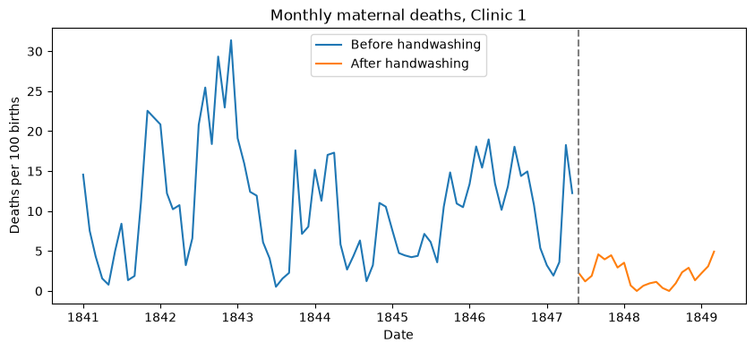

# Dr. Semmelweis and the discovery of handwashing

A re-analysis of the 1840s Vienna General Hospital data that led Ignaz Semmelweis to introduce handwashing, with a bootstrap confidence interval and a permutation test.



## Data

`datasets/yearly_deaths_by_clinic.csv` and `datasets/monthly_deaths.csv`. The data comes from the DataCamp project of the same name.

## Key results

- Before handwashing, 10.5% of women giving birth in Clinic 1 died each month on average; afterwards, 2.1%.
- The drop is 8.4 percentage points (95% bootstrap interval: 6.6 to 10.1).
- None of 10,000 random relabellings of the months produced a drop that large.

## Running the notebook

```bash
pip install -r requirements.txt
jupyter notebook notebook.ipynb
```
